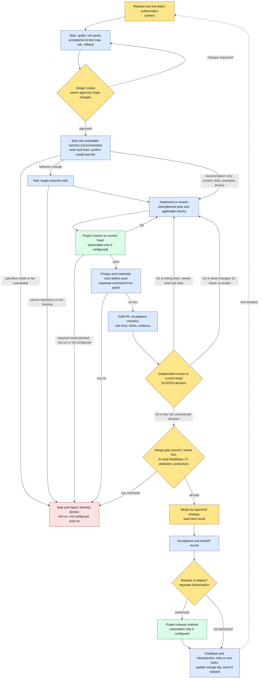

# Workflow v2.1 — templates for AI-assisted development

Language: **English** · [简体中文](README.md)

Workflow v2 is a set of plain-Markdown rules and templates, currently at version **v2.1**, for projects where people and AI agents work on the same codebase. It takes a change from request to a reviewed, tested and traceable result, and it states which steps an AI agent may carry out, which checks are automated, and which decisions belong to a person.

> **Status:** template repository 0.2.0 (unreleased), 0.x; workflow version v2.1 (the rules file is still named `template/docs/workflow-v2.md`). Adapt and validate the templates in each project before relying on them.
> This repository installs nothing. It does not configure CI, apps, tokens, permissions or branch protection, and it deploys nothing.

## What changed in v2.1

Compared with v2, v2.1 adds and changes the following. The full list is in the "Change log" at the end of `template/docs/workflow-v2.md`.

- **Default roles and models** (projects may override them in the configuration table): design and review default to Claude (Opus 5.5, High) in a private Claude Project with this repository attached; coding defaults to Codex cloud (GPT-6.1 Sol, Extra High); technical questions go to a technical research role that checks the official source and attaches links, and if the project has not configured that role, the agent responsible for coding checks the official documentation itself and attaches source links. Before starting, confirm that the specified model and tier can be selected; if not, stop and report.
- **Per-batch loop and severity handling**: implement → strengthened tests → review → handle by severity. S1 (blocking) or failing tests: rework from scratch. S2 (must fix): fix, retest and re-review. S3 and low-risk items: proceed per the review decision. None of this rework requires asking the user.
- **Stop points that require user approval**: in addition to major changes, merging, deployment, rewriting pushed history, credentials, real privacy hits, policy files, new dependencies, work beyond the approved scope and major trade-offs must stop and wait for approval; everything else proceeds automatically within the authorized scope. New dependencies need an architecture assessment first.
- **One-batch authorization and credential isolation**: inventory and request every permission the end-to-end task needs before starting; keys and credentials never land on the agent's work machine.
- **Task briefs and the attribution trailer**: a task brief states the base commit, branch, Draft PR target branch, commit order, hard constraints, acceptance criteria and attribution trailer. The trailer format comes from the repository's attribution script or policy verbatim; if the project has no attribution script or policy file, add one source trailer depending on where the coding agent runs: in the cloud (such as Codex cloud), only the tool identifier, such as `Code-Tool: codex <model> <tier>`, with no Host-Id; only on a local computer, `Host-Id: <host-id>`. Note: for local runs, the host id appears in the public commit history.
- **Separate scan and push**: the privacy and credential scan before every push and release runs as its own command; any hit (including a suspected false positive) means stop and report first.
- **Branches, document delivery and retrospectives**: branches of closed PRs are not deleted; project documents are delivered as a repository link; when a run goes badly, run a retrospective and update the workflow's change log.

## Background

AI agents can draft specs, write code, run tests, open pull requests and review changes. Producing changes is no longer the slow part. The hard part is knowing whether a change does what was asked, who checked it, what was actually run, and who decided it could ship. Workflow v2.1 is a lightweight answer to that: shared roles, a fixed loop, and an evidence record that any person or agent can pick up.

## Why

| Common failure | What Workflow v2.1 does | Where |
|---|---|---|
| "Done" with no proof | Map each acceptance item to a test or check and record the real result | Spec, PR and acceptance templates |
| A test passes but never caught the problem | Write a failing test first, then make the minimal fix (red → green); strengthen tests with race detection where applicable, repeated runs, and coverage of both switch polarities | `workflow-v2.md` loop step 3, per-batch loop |
| The author's self-check or an agent's self-assessment presented as review | Keep implementation and independent review separate; review is tied to the current head; every merge is reviewed first | `workflow-v2.md` |
| Review findings handled ad hoc, or every small issue stalls on the user | Grade by S1/S2/S3: blocking issues go back for rework, must-fix issues are fixed then retested and re-reviewed, low-risk items proceed per the decision | `workflow-v2.md` per-batch loop |
| Green CI treated as approval | Treat CI, review, merge and deployment as separate gates | `workflow-v2.md`, PR template |
| An agent that can push assumes it can merge or deploy | List the stop points that must wait for owner approval; authorize each external action separately; stop on any denial or mismatch | `AGENTS.md.template`, `workflow-v2.md` |
| Access requested piecemeal, credentials scattered on the agent's machine | Request every permission in one batch before starting; credentials never land on the agent's work machine | `workflow-v2.md` |
| Scanning and pushing in one command, so hits get ignored | Scan and push as two separate commands; stop and report on any hit | `workflow-v2.md` |
| Context lost between sessions or agents | Record state, decisions, evidence and next steps in task briefs and handoffs | Handoff template, `workflow-v2.md` |
| Unclear authorship | Keep AI and human contributions identifiable in commits and PRs; copy the trailer from the repository's attribution script, or when there is none, add `Code-Tool:` for cloud runs and `Host-Id:` for local runs | Attribution rules |

## Who

Roles are defined by responsibility, not by product or vendor. v2.1 names default tools and models for some roles, and projects may override them in the configuration table. One person can hold several roles, but the same actor should not implement a change and also give its independent review.

| Role | Filled by | Responsible for | Does not replace |
|---|---|---|---|
| **Owner** | A person accountable for the project | Scope and authorization; approving major changes and stop-point items (merges, releases, deployments and so on); deciding when a Draft PR becomes ready | — |
| **Requirements / design reviewer** | Person or AI (v2.1 default: Claude) | Checking the problem, contracts, risks and acceptance criteria | Owner approval |
| **Implementer** | Usually an AI agent (v2.1 default: Codex cloud); can be a person | Specs, tests, code, running checks, reporting real evidence; reworking per the review's severity | Independent review |
| **Independent reviewer** | Person, separate AI session, or review service, as the project configures (v2.1 default: Claude in a private Claude Project) | Reviewing the current head against the spec and evidence, and giving an S1/S2/S3 decision | Platform approval from another account, where required; the owner's merge approval |
| **Technical research** | Person or AI, as the project configures; if not configured, the agent responsible for coding | Answering questions about technical approaches, API usage and platform rules from the official source, with source links | Review or any approval |
| **Automated checks** | CI or scripts, if the project configures them | Running deterministic checks on a specific commit | Review or any approval |

## When

**Use it** when:
- an AI agent implements or reviews a feature, fix or refactor;
- work passes between people, agents or sessions;
- a change needs an audit trail (security, permissions, data, releases).

**Scale it down** (suggestion) for documentation-only changes. Skip behavioral red/green tests and say why, but still check content, links, examples and privacy.

**During a task**, the gates come in a fixed order: authorization in one batch before starting → design review before implementation → owner approval before any major change → checks on the current head before review, and a separate privacy and credential scan before pushing → review first and a fresh pre-merge check before merging → separate authorization for release or deployment. If another stop point comes up mid-task (for example a new dependency, rewriting pushed history, or work beyond the approved scope), stop and wait for owner approval.

## Where

- **In your project repository.** Copy only the files you need and merge them with your existing rules (see [Adoption](docs/ADOPTION.en.md)). The PR template goes wherever your platform reads it, for example `.github/pull_request_template.md` or `.gitea/pull_request_template.md`. Confirm that your platform supports it.
- **On any platform.** Approvals, protections, checks and review apps differ between platforms such as GitHub and Gitea, so do not assume they are equivalent.
- **In any execution environment.** The default is cloud/API-first, and it is configurable. Any model, agent or provider can fill a role; the v2.1 default roles can be overridden in the configuration table. Before starting, confirm that the specified model and tier can be selected; if not, stop and report, and do not switch models or lower the tier on your own. A user may choose an environment, and tasks that need local files, apps or signed-in sessions run where that access is authorized. Keys and credentials never land on the agent's work machine; steps that need credentials run on the user's own computer or through an authorized connector. Never switch environment, account or access path to get around a denial.
- **Evidence lives in the repository and the PR.** Specs go in `docs/specs/`; validation goes in the PR body; outcomes go in acceptance and handoff records. The repository is the source of truth for project documents; deliver a repository link, not an archive file.

## How — the loop

The diagram is in [Workflow diagram](#workflow-diagram). The steps:

1. **Intake and authorization** (owner). State the goal, non-goals and allowed actions, for example "local only" or "push a task branch and open a draft PR". Before starting, inventory every permission the end-to-end task needs and request them in one batch; if more are needed later, stop and ask under "work beyond the approved scope". Without explicit permission, do not push, merge or deploy.
2. **Spec** (AI drafts or a person writes). Cover the problem, goals and non-goals, invariants, acceptance item → test file/case → input → expected result, risk, rollback, and whether this is a major change. Use `docs/specs/TEMPLATE.md`.
3. **Design review** (reviewer). If changes are requested, go back to step 2. A **major change** needs explicit owner approval. Major changes include permissions/security, protections or required checks, credentials, releases/deployments, data deletion or irreversible migrations, major dependency upgrades, and large cross-system refactors. A written spec is not an approval. The other items that must stop for approval are listed in `workflow-v2.md` under "Major changes and stop points that require user approval".
4. **Decompose and write task briefs** (*splitting is recommended; task-brief requirements are in `workflow-v2.md` under "Handoff and task briefs", with no separate template yet*). Split the work into batches that can each be reviewed on their own, each with its own acceptance items and its own branch/PR. A brief for a coding tool states the base commit, branch name, Draft PR target branch, commit order (spec → failing tests first → implementation), hard constraints, acceptance criteria and attribution trailer. Before starting, confirm that the specified model and tier can be selected.
5. **Red.** Add a test that fails **on the target behavior's assertion**, not on an install or import error.
6. **Green.** Make the minimal change. Run regression tests and every check the project requires, and strengthen tests: race detection where applicable; repeated runs; and coverage of both polarities of feature switches/noop paths. Record each result as passed, failed, skipped, not run, blocked or not configured.
7. **Draft pull request** (PR template). Before pushing, run the privacy and credential scan as its own command, then push with a separate command; stop and report on any scan hit. Include scope, the acceptance checklist, a risk level (low/medium/high, with rollback), exact head/base SHAs, red/green evidence, CI results, and anything unverified. A person decides when the Draft PR becomes ready.
8. **Independent review** of the current head, handled by severity:
   - S1 (blocking) or failing tests: reject, write a rewrite brief, and go back to step 6;
   - S2 (must fix): fix, rerun the same tests, and re-review;
   - S3 and low-risk items: proceed to the next gate per the review decision.

   This rework does not require asking the owner. If the head changes, re-check the affected areas and re-confirm that the review still applies. When stuck, check official documentation, look at comparable mature projects, ask the reviewer, and retry with a different approach; escalate with evidence only after these are exhausted.
   - *Recommended, not implemented:* when several candidate PRs try to solve the same task, compare them against the same acceptance checklist. Any AI-produced ranking is input; the owner decides.
9. **Merge gate** (owner). A review of the current head must exist before merging; never merge first and review later. Re-read the exact head/base, PR state, CI on the current head, review validity, attribution and protections. If anything does not hold, **stop**. Merge only with the project's approved strategy. Never bypass protections, force-push or skip a failing check.
10. **After merge.** Read back the target branch, PR state and actual commit attribution. Record acceptance, remaining risks and the rollback method. Release and deployment need separate authorization.
11. **Feedback and retrospective.** Remaining risks and follow-ups become new tasks. When a run goes badly or a problem is pointed out, run a retrospective: record the lesson in agent memory or a skill, and update the workflow's change log through a PR. Branches of closed PRs are not deleted. Template improvements go through an upgrade PR that compares pinned versions. Rollback is a new revert commit, never a history rewrite. After each task, report the result and state whether there is a next step.

## What is in this repository

| Item | Status | Location |
|---|---|---|
| Workflow rules (roles, default roles, loop, per-batch severity handling, stop points, task briefs, attribution, privacy, retrospectives) | Provided (document, v2.1) | `template/docs/workflow-v2.md` |
| Project rules for agents | Provided (template, references v2.1) | `template/AGENTS.md.template` |
| Spec with acceptance-to-test mapping and red/green evidence | Provided (template) | `template/docs/specs/TEMPLATE.md` |
| PR template with acceptance checklist and risk level | Provided (template) | `template/PULL_REQUEST_TEMPLATE.md` |
| Acceptance record / handoff record | Provided (template) | `template/docs/ACCEPTANCE_TEMPLATE.md`, `HANDOFF_TEMPLATE.md` |
| Adoption, upgrade, rollback and versioning | Provided (guide) | `docs/ADOPTION.en.md` |
| Step-by-step cookbook with a 4-case red/green exercise | Provided (guide, matches v2.1) | `template/COOKBOOK.en.md` |
| S1/S2/S3 grading of review findings and how each is handled | Provided (rules) | `workflow-v2.md`, "Per-batch loop and severity handling" |
| Task-brief requirements | Provided (rules; no separate template yet) | `workflow-v2.md`, "Handoff and task briefs" |
| Test/lint/security commands, independent review mechanism, coding tool and tier, technical research role, attribution trailer source, required checks, merge strategy, release runbook, signing/DCO, execution environment | **Configured per project** (some have v2.1 defaults; the technical research role and attribution trailer source have defaults when not configured) | Adaptation table in `workflow-v2.md` |
| Task-decomposition template, ranking of candidate PRs | **Recommended, not implemented** | — |
| CI workflows, bots, apps, tokens, permissions, protections, auto-merge, deployment, license | **Not provided** | — |

## AI identity and responsibility boundaries

- An AI agent is a contributor working within scope delegated by a person. It holds no approval authority.
- AI output is a proposal or evidence, never a human approval or a guarantee. That covers code, reviews, rankings and summaries.
- An AI review's S1/S2/S3 decision only drives rework; stop points such as moving a Draft PR to ready, merging and deploying are still decided by a person.
- These are different things and must be reported separately:
  - a written spec ≠ an approved spec;
  - a self-check or an agent's self-assessment ≠ independent review;
  - an AI review ≠ formal platform approval from another account;
  - passing CI ≠ approval to merge ≠ approval to deploy;
  - local validation ≠ production validation.
- Commits keep the true source. AI work uses an identifiable AI author and `Agent: <agent-id>`; human work uses `Agent: human`. Trailer keys and format come from the project's attribution script or policy file verbatim; if the project has no attribution script or policy file, add one source trailer depending on where the coding agent runs: in the cloud, the tool identifier (such as `Code-Tool: codex <model> <tier>`), with no Host-Id; only on a local computer, `Host-Id: <host-id>`, which appears in the public commit history. A person's approval does not turn AI work into human work. If the tool cannot set an AI author and project rules allow it, disclose the AI origin and the actual author/committer explicitly. If mandatory identity, DCO or signing rules cannot be met, stop.
- Check existing access before asking for more; when more is needed, ask once, in one batch, before starting. Never request secrets in chat, and keep credentials off the agent's work machine. Report a denial instead of working around it.
- Answer technical questions from the official source, with source links, not from memory; if the project has not configured a technical research role, the agent responsible for coding does this itself.
- Report outcomes as they are: failed, skipped, blocked and not run are not success.

## Quick start

1. Pin a version: a verified tag plus its full commit, or a full commit if there is no tag.
2. Copy the templates you need into your project and merge them with existing rules.
3. Fill in the adaptation table: commands, reviewer, coding tool and tier, technical research role, attribution trailer source, required checks, merge strategy, release boundary. Override the default roles in the table if you do not use them. If the technical research role or attribution trailer source is not configured, use the workflow's defaults; write "not configured" for anything else that does not exist.
4. Run one small task through the loop, or start with the cookbook exercise.
5. Adopt the templates through your project's own review. Copying files does not activate any gate.

## Versions, upgrades and rollback

0.x means the templates still need to be validated in each project. The template repository version (such as 0.2.0) and the workflow version (currently v2.1) are numbered separately: the workflow version is in the title and the change log of `workflow-v2.md`, and the file name does not change with minor versions. Upgrades go through a separate PR that compares two pinned versions. Rollback is a reviewed revert. Upgrading this repository never updates adopting projects automatically. See [Adoption](docs/ADOPTION.en.md) and [Changelog](CHANGELOG.en.md).

## License

No license file is included. These templates are not a license grant.

## Workflow diagram

This is a proposed generic diagram, not a reproduction of a source image, updated for workflow v2.1. Blue: AI or human execution. Yellow: review or human decision gate (independent review can be performed by AI; it is not human approval). Green: automation only when configured. Red: stop and report. Review is graded S1/S2/S3: S1 and S2 go back to implementation without asking the owner, while stop points such as merging and deployment must wait for owner approval. Documentation-only changes skip behavioral red/green and validate content, links, examples and privacy. Missing required checks block progression; an explicitly inapplicable check is recorded with its reason.

