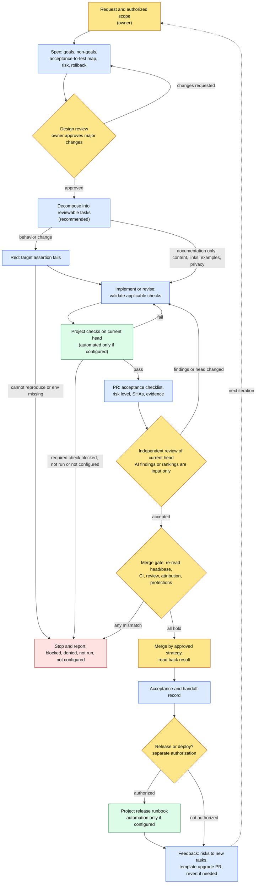

# Workflow v2 — templates for AI-assisted development

Language: **English** · [简体中文](README.md)

Workflow v2 is a set of plain-Markdown rules and templates for projects where people and AI agents work on the same codebase. It takes a change from request to a reviewed, tested and traceable result, and it states which steps an AI agent may carry out, which checks are automated, and which decisions belong to a person.

> **Status:** 0.2.0 (unreleased), 0.x. Adapt and validate the templates in each project before relying on them.
> This repository installs nothing. It does not configure CI, apps, tokens, permissions or branch protection, and it deploys nothing.

## Background

AI agents can draft specs, write code, run tests, open pull requests and review changes. Producing changes is no longer the slow part. The hard part is knowing whether a change does what was asked, who checked it, what was actually run, and who decided it could ship. Workflow v2 is a lightweight answer to that: shared roles, a fixed loop, and an evidence record that any person or agent can pick up.

## Why

| Common failure | What Workflow v2 does | Where |
|---|---|---|
| "Done" with no proof | Map each acceptance item to a test or check and record the real result | Spec, PR and acceptance templates |
| A test passes but never caught the problem | Write a failing test first, then make the minimal fix (red → green) | `workflow-v2.md` step 3 |
| The author's self-check presented as review | Keep implementation and independent review separate; review is tied to the current head | `workflow-v2.md` |
| Green CI treated as approval | Treat CI, review, merge and deployment as separate gates | `workflow-v2.md`, PR template |
| An agent that can push assumes it can merge or deploy | Authorize each external action separately; stop on any denial or mismatch | `AGENTS.md.template` |
| Context lost between sessions or agents | Record state, decisions, evidence and next steps in a handoff | Handoff template |
| Unclear authorship | Keep AI and human contributions identifiable in commits and PRs | Attribution rules |

## Who

Roles are defined by responsibility, not by product or vendor. One person can hold several roles, but the same actor should not implement a change and also give its independent review.

| Role | Filled by | Responsible for | Does not replace |
|---|---|---|---|
| **Owner** | A person accountable for the project | Scope and authorization; approving major changes, merges, releases and deployments | — |
| **Requirements / design reviewer** | Person or AI | Checking the problem, contracts, risks and acceptance criteria | Owner approval |
| **Implementer** | Usually an AI agent; can be a person | Specs, tests, code, running checks, reporting real evidence | Independent review |
| **Independent reviewer** | Person, separate AI session, or review service, as the project configures | Reviewing the current head against the spec and evidence | Platform approval from another account, where required |
| **Automated checks** | CI or scripts, if the project configures them | Running deterministic checks on a specific commit | Review or any approval |

## When

**Use it** when:
- an AI agent implements or reviews a feature, fix or refactor;
- work passes between people, agents or sessions;
- a change needs an audit trail (security, permissions, data, releases).

**Scale it down** (suggestion) for documentation-only changes. Skip behavioral red/green tests and say why, but still check content, links, examples and privacy.

**During a task**, the gates come in a fixed order: authorization before starting → design review before implementation → owner approval before any major change → checks on the current head before review → a fresh pre-merge check before merging → separate authorization for release or deployment.

## Where

- **In your project repository.** Copy only the files you need and merge them with your existing rules (see [Adoption](docs/ADOPTION.en.md)). The PR template goes wherever your platform reads it, for example `.github/pull_request_template.md` or `.gitea/pull_request_template.md`. Confirm that your platform supports it.
- **On any platform.** Approvals, protections, checks and review apps differ between platforms such as GitHub and Gitea, so do not assume they are equivalent.
- **In any execution environment.** The default is cloud/API-first, and it is configurable. Any model, agent or provider can fill a role. A user may choose an environment, and tasks that need local files, apps or signed-in sessions run where that access is authorized. Never switch environment, account or access path to get around a denial.
- **Evidence lives in the repository and the PR.** Specs go in `docs/specs/`; validation goes in the PR body; outcomes go in acceptance and handoff records.

## How — the loop

The diagram is in [Workflow diagram](#workflow-diagram). The steps:

1. **Intake and authorization** (owner). State the goal, non-goals and allowed actions, for example "local only" or "push a task branch and open a draft PR". Without explicit permission, do not push, merge or deploy.
2. **Spec** (AI drafts or a person writes). Cover the problem, goals and non-goals, invariants, acceptance item → test file/case → input → expected result, risk, rollback, and whether this is a major change. Use `docs/specs/TEMPLATE.md`.
3. **Design review** (reviewer). If changes are requested, go back to step 2. A **major change** needs explicit owner approval. Major changes include permissions/security, protections or required checks, credentials, releases/deployments, data deletion or irreversible migrations, major dependency upgrades, and large cross-system refactors. A written spec is not an approval.
4. **Decompose** (*recommended; no template yet*). Split the work into changes that can each be reviewed on their own, each with its own acceptance items and its own branch/PR.
5. **Red.** Add a test that fails **on the target behavior's assertion**, not on an install or import error.
6. **Green.** Make the minimal change. Run regression tests and every check the project requires. Record each result as passed, failed, skipped, not run, blocked or not configured.
7. **Pull request** (PR template). Include scope, the acceptance checklist, a risk level (low/medium/high, with rollback), exact head/base SHAs, red/green evidence, CI results, and anything unverified.
8. **Independent review** of the current head. Findings go back to step 6. If the head changes, re-check the affected areas and re-confirm that the review still applies.
   - *Recommended, not implemented:* order findings by severity. When several candidate PRs try to solve the same task, compare them against the same acceptance checklist. Any AI-produced ranking is input; the owner decides.
9. **Merge gate** (owner). Re-read the exact head/base, PR state, CI on the current head, review validity, attribution and protections. If anything does not hold, **stop**. Merge only with the project's approved strategy. Never bypass protections, force-push or skip a failing check.
10. **After merge.** Read back the target branch, PR state and actual commit attribution. Record acceptance, remaining risks and the rollback method. Release and deployment need separate authorization.
11. **Feedback.** Remaining risks and follow-ups become new tasks. Template improvements go through an upgrade PR that compares pinned versions. Rollback is a new revert commit, never a history rewrite.

## What is in this repository

| Item | Status | Location |
|---|---|---|
| Workflow rules (roles, loop, gates, attribution, privacy) | Provided (document) | `template/docs/workflow-v2.md` |
| Project rules for agents | Provided (template) | `template/AGENTS.md.template` |
| Spec with acceptance-to-test mapping and red/green evidence | Provided (template) | `template/docs/specs/TEMPLATE.md` |
| PR template with acceptance checklist and risk level | Provided (template) | `template/PULL_REQUEST_TEMPLATE.md` |
| Acceptance record / handoff record | Provided (template) | `template/docs/ACCEPTANCE_TEMPLATE.md`, `HANDOFF_TEMPLATE.md` |
| Adoption, upgrade, rollback and versioning | Provided (guide) | `docs/ADOPTION.en.md` |
| Step-by-step cookbook with a 4-case red/green exercise | Provided (guide) | `template/COOKBOOK.en.md` |
| Test/lint/security commands, independent review mechanism, required checks, merge strategy, release runbook, signing/DCO, execution environment | **Configured per project** | Adaptation table in `workflow-v2.md` |
| Task decomposition, ranking of candidate PRs, severity ordering of findings | **Recommended, not implemented** | — |
| CI workflows, bots, apps, tokens, permissions, protections, auto-merge, deployment, license | **Not provided** | — |

## AI identity and responsibility boundaries

- An AI agent is a contributor working within scope delegated by a person. It holds no approval authority.
- AI output is a proposal or evidence, never a human approval or a guarantee. That covers code, reviews, rankings and summaries.
- These are different things and must be reported separately:
  - a written spec ≠ an approved spec;
  - a self-check ≠ independent review;
  - an AI review ≠ formal platform approval from another account;
  - passing CI ≠ approval to merge ≠ approval to deploy;
  - local validation ≠ production validation.
- Commits keep the true source. AI work uses an identifiable AI author and `Agent: <agent-id>`; human work uses `Agent: human`. A person's approval does not turn AI work into human work. If the tool cannot set an AI author and project rules allow it, disclose the AI origin and the actual author/committer explicitly. If mandatory identity, DCO or signing rules cannot be met, stop.
- Check existing access before asking for more. Never request secrets in chat. Report a denial instead of working around it.
- Report outcomes as they are: failed, skipped, blocked and not run are not success.

## Quick start

1. Pin a version: a verified tag plus its full commit, or a full commit if there is no tag.
2. Copy the templates you need into your project and merge them with existing rules.
3. Fill in the adaptation table: commands, reviewer, required checks, merge strategy, release boundary. Write "not configured" where something does not exist.
4. Run one small task through the loop, or start with the cookbook exercise.
5. Adopt the templates through your project's own review. Copying files does not activate any gate.

## Versions, upgrades and rollback

0.x means the templates still need to be validated in each project. Upgrades go through a separate PR that compares two pinned versions. Rollback is a reviewed revert. Upgrading this repository never updates adopting projects automatically. See [Adoption](docs/ADOPTION.en.md) and [Changelog](CHANGELOG.en.md).

## License

No license file is included. These templates are not a license grant.

## Workflow diagram

This is a proposed generic diagram, not a reproduction of a source image. Blue: AI or human execution. Yellow: review or human decision gate (independent review can be performed by AI; it is not human approval). Green: automation only when configured. Red: stop and report. Documentation-only changes skip behavioral red/green and validate content, links, examples and privacy. Missing required checks block progression; an explicitly inapplicable check is recorded with its reason.

