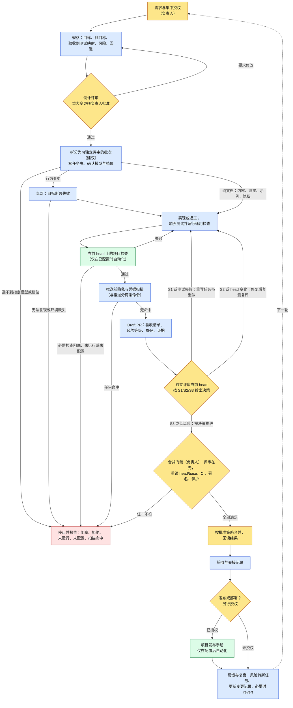

# Workflow v2.1：AI 协作开发工作流模板

语言：[English](README.en.md) · **简体中文**

Workflow v2 是一组纯 Markdown 的规则和模板，当前版本为 **v2.1**，适用于人和 AI agent 在同一代码库协作的项目。它把一次修改从需求带到“经过评审、测试、可追溯”的结果，并写清楚：哪些步骤可以由 AI agent 执行，哪些检查是自动化的，哪些决定必须由人做出。

> **状态：** 模板仓 0.2.0（未发布），0.x；workflow 版本 v2.1（规则文件名仍为 `template/docs/workflow-v2.md`）。依赖这些模板之前，需要先在各项目中适配和验证。
> 本仓库不安装任何东西，不配置 CI、App、token、权限或分支保护，也不部署任何东西。

## v2.1 改动摘要

相对 v2，v2.1 新增和调整了以下内容。完整说明见 `template/docs/workflow-v2.md` 文末的「变更记录」。

- **默认分工与模型**（项目可在适配表覆盖）：设计与评审默认由 Claude 承担（Opus 5.5，High），在挂载本仓库的私有 Claude Project 中进行；编码默认用 Codex 云端（GPT-6.1 Sol，Extra High）；技术问题交技术研究角色查官方原文并附链接，项目没有配置该角色时，由负责编程的 agent 自己查官方文档并附来源链接。启动前须确认能选到指定模型与档位，选不到就停下回报。
- **每批闭环与分级处理**：实现 → 加强测试 → 评审 → 分级处理。S1（阻断）或测试不过时直接返工重做；S2（需修复）修后复测复评；S3 与低风险项按评审决策推进。这些返工不需要问用户。
- **需用户批准的停止点**：除重大变更外，合并、部署、改写已推送历史、凭据、真实隐私命中、政策文件、新增依赖、超出已批准范围、重大取舍都必须停下等批准；其余在已授权范围内自动推进。新增依赖先做架构评估。
- **集中授权与凭据隔离**：开工前一次盘点并申请端到端所需的全部权限；密钥与凭据不落 agent 工作机。
- **任务书与署名 trailer**：任务书写明基点 commit、分支、Draft PR 目标分支、提交顺序、硬约束、验收标准和署名 trailer。trailer 格式以仓库署名脚本或策略原文为准；项目没有署名脚本或策略文件时，按编码 agent 的运行环境另加来源 trailer：云端运行（如 Codex 云端）只写工具标识，如 `Code-Tool: codex <模型> <档位>`，不写 Host-Id；本地电脑运行写同样的工具标识并加 `Host-Id: <host-id>`。注意：本地运行时 host id 会出现在公开的提交记录里。
- **扫描与推送分离**：推送和发布前的隐私与凭据扫描单独执行；任何命中（包括疑似误报）都先停下上报。
- **分支、文档交付与复盘**：不删除已关闭 PR 的分支；项目文档交付时给仓库链接；运行不顺时复盘，并更新 workflow 的变更记录。

## 背景

AI agent 已经能写规格、写代码、跑测试、开 PR、评审改动。产出改动已经不慢，难的是确认：改动是否满足需求，谁检查过，实际运行了什么，谁决定可以上线。Workflow v2.1 给出一个轻量的回答：共同的角色、固定的闭环，以及任何人或 agent 都能接手的证据记录。

## 为什么需要（Why）

| 常见问题 | Workflow v2.1 的做法 | 位置 |
|---|---|---|
| 说“完成了”却没有证据 | 每条验收对应测试或检查，并记录真实结果 | spec、PR、验收模板 |
| 测试通过，但它根本没抓到问题 | 先写失败测试，再做最小修复（红 → 绿）；加强测试：适用时做竞态检测；多次连跑；开关两种极性都覆盖 | `workflow-v2.md` 闭环第 3 步、每批闭环 |
| 把作者自查或代理自评当成评审 | 实现与独立评审分开；评审对应当前 head；每次合并都先评审 | `workflow-v2.md` |
| 评审发现处理随意，或每个小问题都停下问人 | 按 S1/S2/S3 分级：阻断直接返工，需修复的修后复测复评，低风险按决策推进 | `workflow-v2.md` 每批闭环 |
| 把 CI 通过当作批准 | CI、评审、合并、部署是不同的门禁 | `workflow-v2.md`、PR 模板 |
| 能推送的 agent 默认自己也能合并或部署 | 列出必须等负责人批准的停止点；每个对外操作单独授权；遇到拒绝或不一致就停止 | `AGENTS.md.template`、`workflow-v2.md` |
| 授权一步一步补，凭据散落在 agent 工作机 | 开工前集中申请全部权限；凭据不落 agent 工作机 | `workflow-v2.md` |
| 扫描与推送混在一条命令里，命中被忽略 | 扫描与推送分两条命令；任何命中先停下上报 | `workflow-v2.md` |
| 换会话或换 agent 后上下文丢失 | 任务书和交接记录写明状态、决定、证据和下一步 | 交接模板、`workflow-v2.md` |
| 作者来源不清 | 提交和 PR 中保持 AI 与人工来源可识别；trailer 照抄仓库署名脚本，没有脚本时云端运行加 `Code-Tool:`，本地电脑运行加 `Code-Tool:` 和 `Host-Id:` | 署名规则 |

## 给谁用（Who）

角色按职责划分，不按产品或厂商。v2.1 为部分角色给出默认工具和模型，项目可在适配表中覆盖。一个人可以兼任多个角色，但同一个执行者不应既实现一项改动、又为它做独立评审。

| 角色 | 由谁担任 | 负责 | 不能替代 |
|---|---|---|---|
| **负责人** | 对项目负责的人 | 范围与授权；批准重大变更和停止点事项（合并、发布、部署等）；决定 Draft PR 何时转为 ready | — |
| **需求/设计评审者** | 人或 AI（v2.1 默认 Claude） | 检查问题、契约、风险和验收标准 | 负责人批准 |
| **实现者** | 通常是 AI agent（v2.1 默认 Codex 云端），也可以是人 | 规格、测试、代码、运行检查、提供真实证据；按评审分级返工 | 独立评审 |
| **独立评审者** | 人、独立的 AI 会话或评审服务，由项目配置（v2.1 默认 Claude，在私有 Claude Project 中） | 对照规格和证据评审当前 head，给出 S1/S2/S3 决策 | 平台要求时，另一账号的正式批准；负责人的合并批准 |
| **技术研究** | 人或 AI，由项目配置；项目没有配置时由负责编程的 agent 承担 | 查官方原文并附来源链接，回答技术方案、API 用法、平台规则类问题 | 评审或任何批准 |
| **自动检查** | 项目配置的 CI 或脚本（如有） | 对指定提交运行确定性检查 | 评审或任何批准 |

## 何时使用（When）

**适合使用**：
- AI agent 实现或评审功能、修复、重构；
- 工作在人、agent 或会话之间交接；
- 改动需要审计记录（安全、权限、数据、发布）。

**可以简化**（建议）：纯文档改动跳过行为红绿测试并说明原因，但仍要检查内容、链接、示例和隐私。

**任务中的门禁顺序固定**：开始前集中确认授权 → 实现前做设计评审 → 重大变更前取得负责人批准 → 评审前在当前 head 上跑检查，推送前单独做隐私与凭据扫描 → 合并前先评审并重新核对 → 发布或部署另行授权。任务中途遇到其他停止点（如新增依赖、改写已推送历史、超出已批准范围），随时停下等负责人批准。

## 在哪里用（Where）

- **在你的项目仓库里。** 只复制需要的文件，并与已有规则合并（见[采用指南](docs/ADOPTION.md)）。PR 模板放在平台识别的位置，例如 `.github/pull_request_template.md` 或 `.gitea/pull_request_template.md`，先确认平台支持。
- **任何代码托管平台。** GitHub、Gitea 等平台的审批、保护、检查和评审 App 能力不同，不要假定它们等价。
- **任何执行环境。** 默认云端/API 优先，可以配置。任何模型、agent 或服务商都可以担任角色；v2.1 的默认分工可在适配表覆盖。启动前须确认能选到指定模型与档位，选不到就停下回报，不自行换模型或降档。用户可以指定环境；需要本地文件、应用或已登录会话的任务，在有合法访问权限的环境中执行。密钥与凭据不落 agent 工作机，需要凭据的步骤在用户本机或已授权的连接器中完成。绝不为绕过拒绝而更换环境、账户或访问路径。
- **证据留在仓库和 PR 中。** 规格放在 `docs/specs/`；验证写在 PR 正文；结果写在验收和交接记录里。项目文档以仓库为准，交付时给仓库链接，不发压缩包。

## 怎么做：闭环（How）

流程图见[工作流程图](#工作流程图)。步骤如下：

1. **接收需求与授权**（负责人）。写明目标、非目标和允许的操作，例如“仅本地”或“推送任务分支并开 Draft PR”。开工前一次盘点端到端所需的全部权限并集中申请；之后如需更多权限，按“超出已批准范围”停下请示。没有明确许可，不推送、不合并、不部署。
2. **规格**（AI 起草或人编写）。写清问题、目标与非目标、不变量，验收条目 → 测试文件/用例 → 输入 → 预期，风险、回退，以及是否属于重大变更。使用 `docs/specs/TEMPLATE.md`。
3. **设计评审**（评审者）。要求修改时回到第 2 步。**重大变更**必须取得负责人的明确批准。重大变更包括权限/安全、保护或 required checks、凭据、发布/部署、数据删除或不可逆迁移、依赖主版本升级、跨系统的大重构。写好的 spec 不等于已批准。其余必须停下等批准的事项见 `workflow-v2.md`「重大变更与需用户批准的停止点」。
4. **任务分解与任务书**（*拆分是建议；任务书要求见 `workflow-v2.md`「交接与任务书」，尚无独立模板*）。把工作拆成可以单独评审的批次，每批有自己的验收条目，以及自己的分支/PR。交给编码工具的任务书写明基点 commit、分支名、Draft PR 目标分支、提交顺序（规格 → 先红的测试 → 实现）、硬约束、验收标准和署名 trailer。启动前确认能选到指定模型与档位。
5. **红灯。** 先写一个**因目标行为断言而失败**的测试，而不是因安装或导入错误失败。
6. **绿灯。** 做最小修改。运行回归测试和项目要求的全部检查，并加强测试：适用时做竞态检测；多次连跑；功能开关/noop 两种极性都覆盖。逐项把结果记为：通过、失败、跳过、未运行、阻塞、未配置。
7. **提交 Draft PR**（PR 模板）。推送前先单独运行隐私与凭据扫描，再用另一条命令推送；扫描有任何命中都先停下上报。PR 写明范围、验收清单、风险等级（低/中/高及回退方式）、精确的 head/base SHA、红绿证据、CI 结果和未验证事项。Draft PR 何时转为 ready 由人决定。
8. **独立评审**当前 head，并按分级处理：
   - S1（阻断）或测试不过：直接驳回，写重写任务书，回到第 6 步重做；
   - S2（需修复）：修复后重新跑同一套测试并复评；
   - S3 与低风险项：按评审决策推进到下一个门禁。

   以上返工不需要问负责人。head 变化后，重新检查受影响部分，并重新确认评审是否仍然有效。卡住时先查官方文档、参考同类成熟项目、问评审者、换方法重试，穷尽这些手段后再附证据上报。
   - *建议，尚未实现：* 同一任务有多个候选 PR 时，用同一份验收清单比较它们。AI 给出的排序只是参考，由负责人决定。
9. **合并门禁**（负责人）。合并前必须已有针对当前 head 的评审，不先合后审。重新读取精确的 head/base、PR 状态、当前 head 的 CI、评审有效性、署名和保护设置。任何一项不符就**停止**。只按项目批准的策略合并。不绕过保护、不强推、不跳过失败的检查。
10. **合并后。** 回读目标分支、PR 状态和实际的提交署名。记录验收结果、剩余风险和回退方法。发布和部署需要另行授权。
11. **反馈与复盘。** 剩余风险和后续事项转成新任务。运行不顺或被指出问题时主动复盘：教训写进 agent 记忆或技能，并通过 PR 更新 workflow 的变更记录。已关闭 PR 的分支不删除。模板改进通过升级 PR 进行，对比两个固定版本。回退用新的 revert 提交，不改写历史。每项任务完成后汇报结果，并说明是否还有下一步。

## 本仓库提供什么（What）

| 项目 | 状态 | 位置 |
|---|---|---|
| 工作流规则（角色、默认分工、闭环、每批分级处理、停止点、任务书、署名、隐私、复盘） | 已提供（文档，v2.1） | `template/docs/workflow-v2.md` |
| 给 agent 的项目规则 | 已提供（模板，引用 v2.1） | `template/AGENTS.md.template` |
| 含“验收 → 测试”映射和红绿证据的 spec | 已提供（模板） | `template/docs/specs/TEMPLATE.md` |
| 含验收清单与风险等级的 PR 模板 | 已提供（模板） | `template/PULL_REQUEST_TEMPLATE.md` |
| 验收记录 / 交接记录 | 已提供（模板） | `template/docs/ACCEPTANCE_TEMPLATE.md`、`HANDOFF_TEMPLATE.md` |
| 采用、升级、回退与版本约定 | 已提供（指南） | `docs/ADOPTION.md` |
| 分步 Cookbook 与 4 用例红绿演练 | 已提供（指南，对应 v2.1） | `template/COOKBOOK.md` |
| 评审发现的 S1/S2/S3 分级与处理方式 | 已提供（规则） | `workflow-v2.md`「每批闭环与分级处理」 |
| 任务书要求 | 已提供（规则；尚无独立模板） | `workflow-v2.md`「交接与任务书」 |
| 测试/lint/安全命令、独立评审方式、编码工具与档位、技术研究角色、署名 trailer 来源、required checks、合并策略、发布手册、签名/DCO、执行环境 | **按项目配置**（部分有 v2.1 默认值；技术研究角色和署名 trailer 来源没有配置时有默认做法） | `workflow-v2.md` 中的项目适配表 |
| 任务分解模板、候选 PR 排序 | **建议，尚未实现** | — |
| CI workflow、机器人、App、token、权限、保护、自动合并、部署、许可证 | **不提供** | — |

## AI 身份与责任边界

- AI agent 是在人授权的范围内工作的贡献者，没有批准权。
- AI 的产出只是提议或证据，不是人的批准，也不是保证。这包括代码、评审、排序和总结。
- AI 评审给出的 S1/S2/S3 决策只用于驱动返工；Draft PR 转 ready、合并、部署等停止点仍由人决定。
- 下面这些是不同的事，必须分开报告：
  - 写好的 spec ≠ 已批准的 spec；
  - 自查或代理自评 ≠ 独立评审；
  - AI 评审 ≠ 平台上另一账号的正式批准；
  - CI 通过 ≠ 可以合并 ≠ 可以部署；
  - 本地验证 ≠ 生产验证。
- 提交保留真实来源。AI 的改动使用可识别的 AI 作者和 `Agent: <agent-id>`；人的改动使用 `Agent: human`。trailer 的键名和格式以项目署名脚本或策略文件原文为准；项目没有署名脚本或策略文件时，按编码 agent 的运行环境另加来源 trailer：云端运行写工具标识（如 `Code-Tool: codex <模型> <档位>`），不写 Host-Id；本地电脑运行写同样的工具标识并加 `Host-Id: <host-id>`，并且 host id 会出现在公开的提交记录里。人批准了 AI 的改动，并不会把它变成人的改动。工具不能设置 AI 作者、且项目规则允许时，明确披露 AI 来源和实际的 author/committer。强制身份、DCO 或签名要求无法满足时，停止。
- 先核实已有的访问权限，再考虑申请更多；需要申请时，开工前一次集中提出。不在聊天中索要密钥，凭据不落 agent 工作机。遇到拒绝就报告，不绕过。
- 技术问题查官方原文并附来源链接，不凭印象回答；项目没有配置技术研究角色时，由负责编程的 agent 自己查。
- 如实报告结果：失败、跳过、阻塞、未运行都不算成功。

## 快速开始

1. 固定版本：已核验的 tag 加完整 commit；没有 tag 时用完整 commit。
2. 把需要的模板复制到项目，并与已有规则合并。
3. 填写项目适配表：命令、评审者、编码工具与档位、技术研究角色、署名 trailer 来源、required checks、合并策略、发布边界。不使用默认分工时在表中覆盖。技术研究角色和署名 trailer 来源没有配置时按 workflow 的默认做法填写；其余不存在的项写“未配置”。
4. 用一个小任务跑一遍闭环，或先做 Cookbook 里的演练。
5. 通过项目自己的评审来采用模板。只复制文件不会让任何门禁生效。

## 版本、升级与回退

0.x 表示模板仍需在各项目中验证。模板仓版本（如 0.2.0）与 workflow 版本（当前 v2.1）分开编号：workflow 版本写在 `workflow-v2.md` 的标题和文末变更记录中，文件名不随小版本变化。升级通过单独的 PR 进行，对比两个固定版本。回退用经过评审的 revert。更新本仓库不会自动更新已采用它的项目。详见[采用指南](docs/ADOPTION.md)和[变更记录](CHANGELOG.md)。

## 许可证

本仓库没有许可证文件。这些模板不构成许可授权。

## 工作流程图

这是拟定的通用流程图，不是对来源原图的复用，已按 workflow v2.1 更新。蓝色：AI 或人执行；黄色：评审或人工决策门禁（独立评审可由 AI 执行，不等于人工批准）；绿色：仅在配置后自动化；红色：停止并报告。评审按 S1/S2/S3 分级：S1、S2 回到实现返工，不需要问负责人；合并、部署等停止点必须等负责人批准。纯文档变更跳过行为红绿测试，改为核验内容、链接、示例和隐私。缺少必需检查时停止推进；明确不适用的检查须记录理由。

